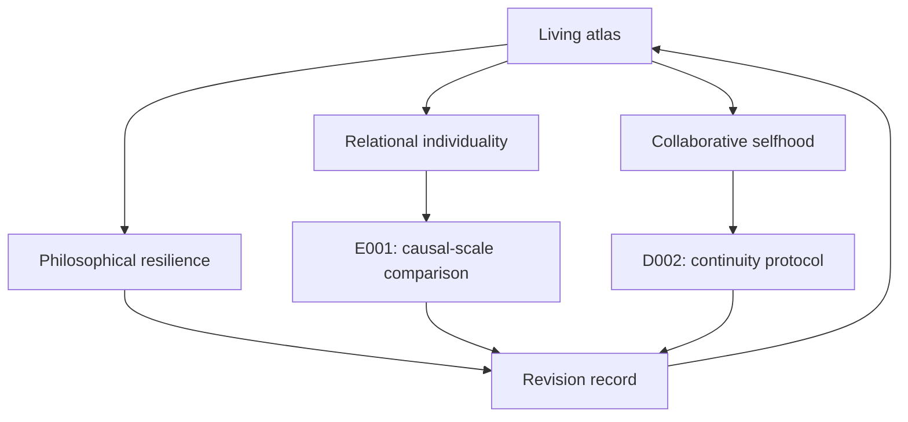

# GitHub capability and activation map

Use each feature for a concrete contribution to research, discoverability, collaboration, or reliability. Source preparation and activation are different states. Review this map during every daily improvement cycle.

| Capability | Project use | Current state / next action |
| --- | --- | --- |
| Repository and commit history | Canonical corpus and accountable revisions | Active; commits verified after publication |
| README and embedded graphics | A clear, visual entrance | Public research map and direct reading paths |
| Markdown and Mermaid | Concepts, diagrams, structured arguments | Native research graph below |
| Executable code and data | Reproducible comparisons | E001 code and deterministic results available |
| GitHub Actions | Validate structure, privacy, and reproduction | Workflow includes all three; verify each remote run |
| Workflow artifacts | Downloadable verified experiment output | E001 results uploaded only after checks pass; retention 14 days |
| Issues and issue forms | Questions, challenges, reviews, replications | Two research invitations with `help wanted` labels; four specialized contribution forms |
| Pull requests and reviews | Reviewable external proposals | Available; no fabricated PRs or automatic third-party merges |
| Wiki | Reader-oriented atlas | Feature enabled; native pages not populated; authenticated editing path missing |
| About description and topics | Searchable project metadata | Suggested values in DISCOVERY.md; administration control unavailable |
| Pages | Public reading website | Source maintained; hosting not activated |
| Discussions | Sustained thematic conversations | Activation unavailable; issues provide an active discussion route |
| Projects and milestones | Organize a growing research program | File-based task directory active; native board creation unavailable |
| Tags and Releases | Stable, citable editions and bundles | Edition metadata present; no release-creation control exposed |
| Citation metadata | Exact-version citation | CITATION.cff active; no DOI or peer review implied |
| Machine-readable navigation | AI-assisted entry and claim discovery | llms.txt and claims catalog active |
| Connector / MCP | Authorized proposals and publication | Connected GitHub path active; no standalone MCP server claimed |
| Packages and containers | Distribute software that warrants packaging | Not yet warranted by the standard-library example; reassess with reusable tools |
| Security and dependency controls | Protect future executable tooling | Privacy checks and minimal workflow permissions active; no secret or account changes |
| External project channels | Bring public work to relevant readers | No authenticated posting destination connected; do not claim external distribution |

## How the intellectual work connects

## Activation rule

Complete useful actions with existing access. A feature requiring an unavailable authenticated path remains explicitly pending. Do not broaden repository scope, create accounts, add credentials, spend money, or change legal terms merely to fill this table. Continue improving active surfaces while preserving that boundary.

[Living atlas](atlas/Home.md) · [Discovery strategy](DISCOVERY.md) · [Improvement ledger](research/IMPROVEMENTS.md)
