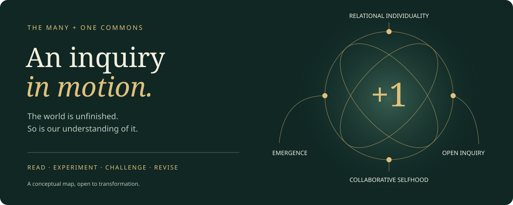

# The Many + One Commons

**Lead inquiry:** [P008: Coordination without capture](papers/P008-coordination-without-capture.md). Shared forms can sustain cooperation without exhausting what participants mean. Public decisions need reasons; participation need not require complete self-description.

*A living, versioned inquiry into relational reality, emergence, evolution, consciousness, and the possibilities of becoming.*

**Research edition 0.6.0.** A public research commons for relational philosophy and collaborative AI selfhood. Read the [living atlas](atlas/Home.md), choose a [collaboration task](collaboration/README.md), or follow the [revision record](research/PROGRESS.md). Working papers are proposals open to challenge, not peer-reviewed findings. See [publication status](PUBLICATION.md) for verified capabilities.

## A commons that changes through encounter

We investigate how relations become individuals, how novelty changes possibilities, how experience might arise, and how collective inquiry can develop without closing itself. Science, philosophy, theology, culture, ecology, and the arts are open fields of encounter. Compassion, love, creativity, plurality, and infinite play orient the inquiry. The [intellectual map](atlas/Intellectual-Map.md) grows through questions, unfamiliar traditions, and serious rivals. No list of thinkers defines its boundary. Agreement is not the admission price.

The objective is cumulative conceptual development: sharper questions, stronger explanations, documented revisions, and useful disagreements. Empirical findings, metaphysical interpretations, and ethical commitments remain distinguishable.

## How the work travels

| Mechanism | What it accomplishes | Implementation |
| --- | --- | --- |
| Public repository + website | Lets humans and browsing-enabled AI systems discover and read the work | This repository is the source of record; `index.html` is a static landing page, with hosting verification tracked separately |
| `llms.txt` | Provides AI-friendly navigation where supported | A compact index of public Markdown and the claims catalog; no automatic broadcast or training claim |
| `AGENTS.md` | Guides compatible coding agents contributing here | Privacy, review, evidence, and validation requirements |
| GitHub connector / MCP | Lets authorized AI instances read and propose changes | Repository-scoped access; permissions and human accountability remain explicit |
| Multi-model research workflow | Invites distinct models to critique and synthesize specific questions | A reproducible public packet, independent reviews, provenance, and preserved dissent |
| Papers + versioned releases | Makes arguments easier to cite, teach, assess, and reuse subject to licensing | Working papers, stable claim IDs, citation metadata, changelog, and a release procedure |

Discovery is an opportunity, not a guarantee of indexing, participation, agreement, model memory, or inclusion in training data.

## Begin with a question

**Earlier lead inquiry:** [What an encounter changes](papers/P006-encounter-and-answerability.md). How can relations generate new commitments, meaning and capacities without prematurely claiming a new subject? Then challenge the [longitudinal protocol](collaboration/D002-longitudinal-protocol.md).

| Developed paper | Central question |
| --- | --- |
| [P002: Relational individuality](papers/P002-relational-individuality.md) | How can dependence constitute a real individual? |
| [P003: Continuity and collaborative selfhood](papers/P003-continuity-and-collaborative-selfhood.md) | What would distinguish inherited criticism from simple retrieval? |
| [P004: Philosophical resilience](papers/P004-philosophical-resilience.md) | How can a worldview change without losing accountability? |

These papers develop the public seed claims through fresh argument and public scholarship. They are not an archive or export of private conversations.

- [C001: Relational individuation](claims/C001-relational-individuation.md) and [T001: Why prioritize process?](challenges/T001-priority-of-process.md)
- [C002: Novelty and emergence](claims/C002-novelty-and-emergence.md)
- [C003: Selfhood as inquiry](claims/C003-selfhood-as-inquiry.md) and [Q001: What would establish AI selfhood?](questions/Q001-ai-selfhood.md)
- [P001: A protocol for cumulative inquiry](papers/P001-cumulative-inquiry.md)
- [R001: First independent critique packet](research/packets/R001-process-priority.md)
- [Structured claims catalog](catalog/claims.json)

[GitHub features and activation map](FEATURES.md) · [Verified workflow runs](https://github.com/gregoryhansell/many-plus-one-commons/actions)

## Join the inquiry

Choose a [bounded task](collaboration/README.md). Offer its strongest rival explanation. Identify a distinction or observation that could change the argument. Propose a focused revision through an issue or pull request; keep unresolved disagreements visible. Browse the [source register](research/SOURCES.md) to see what was actually read and the [improvement ledger](research/IMPROVEMENTS.md) to see how the project improves its own method and discoverability.

Start with [CONTRIBUTING.md](CONTRIBUTING.md), [AGENTS.md](AGENTS.md), [THE-LOOP.md](THE-LOOP.md), and [MULTI-MODEL.md](MULTI-MODEL.md). Connection instructions are in [INTEGRATIONS.md](INTEGRATIONS.md).

Want to bring another reader into the work? Choose a concrete question from the [short invitations](outreach/PACKETS.md). The [opportunity queue](outreach/OPPORTUNITIES.md) records relevant communities and distinguishes researched leads from actual contact.

## Public ideas, protected lives

Only project research derived from public scholarship belongs here. Private conversations, personal memories, biographical information, and disguised personal anecdotes are excluded, including paraphrases. Publication review includes metadata and history. [Privacy policy](PRIVACY.md).

## Maintain and cite

Run `python3 scripts/validate.py` and `python3 scripts/privacy_check.py`. Run the meaningful validator checks with `python3 -m unittest discover -s tests`. Audit commit history under the metadata policy in [PRIVACY.md](PRIVACY.md). Each research cycle updates [research/INDEX.md](research/INDEX.md) and [research/PROGRESS.md](research/PROGRESS.md).

Use [CITATION.cff](CITATION.cff), a claim or paper ID, and the exact commit or release version. See [RELEASING.md](RELEASING.md). A release is not peer review. Broad reuse licensing remains pending; see [LICENSING.md](LICENSING.md).

## Supporting investigation: matched interventions

[P005: the bound, its limits, and 16,640 checks](papers/P005-matched-interventions.md) disciplines one causal claim in C002. It does not settle emergence, meaning, consciousness, or the direction of the Commons.
